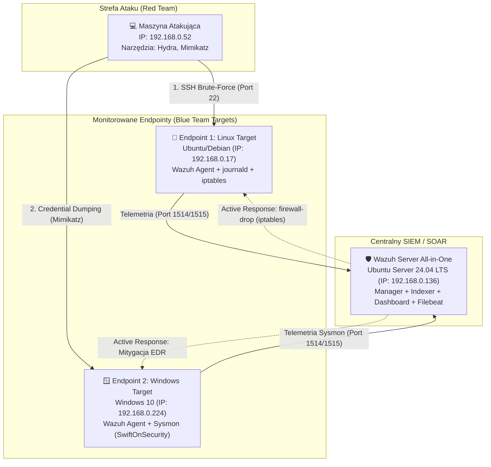

# 🛡️ Wdrożenie Środowiska Wazuh SIEM & EDR: Detection Engineering & SOAR Home Lab

## 📋 Streszczenie Managerskie (Executive Summary)
Projekt prezentuje kompleksowe zaprojektowanie, wdrożenie oraz utrzymanie centralnego środowiska monitorowania bezpieczeństwa (**SIEM/EDR**) w architekturze *On-Premise*. Głównym celem laboratorium jest praktyczna demonstracja umiejętności z zakresu:
* **Inżynierii Detekcji (Detection Engineering):** Tworzenie autorskich reguł korelacyjnych w oparciu o logi systemowe (`journald`) oraz zaawansowaną telemetrię endpointową (`Sysmon`), z pełnym mapowaniem do matrycy **MITRE ATT&CK**.
* **Automatyzacji Reakcji na Incydenty (SOAR / Active Response):** Konfiguracja mechanizmów aktywnej obrony, które w czasie rzeczywistym mitygują zagrożenia (automatyczna blokada agresora w `iptables` na systemie Linux oraz neutralizacja złośliwych procesów na stacji Windows) bez udziału analityka.
* **Administracji i Troubleshootingu Infrastruktury SIEM:** Rozwiązywanie rzeczywistych problemów produkcyjnych obejmujących zarządzanie wolumenami logicznymi (LVM), uwierzytelnianie usług (Filebeat Keystore, OpenSearch Security, RBAC API) oraz uprawnienia systemowe.

---

## 🏗️ Architektura Środowiska (Lab Topology)

Środowisko zostało zbudowane w oparciu o wirtualizację w sieci mostkowanej (*Bridged Network*), co pozwala na symulację rzeczywistego ruchu sieciowego w segmencie LAN (`192.168.0.0/24`).



### Specyfikacja komponentów:
| Rola w architekturze | System operacyjny | Adres IP | Kluczowe moduły i konfiguracja |
|---|---|---|---|
| **Wazuh Server (SIEM)** | Ubuntu Server 24.04 LTS | `192.168.0.136` | Wazuh Manager, Wazuh Indexer, Wazuh Dashboard, Filebeat (`4.14.9`) |
| **Endpoint 1 (Linux Target)** | Ubuntu / Debian | `192.168.0.17` | Wazuh Agent, kolektywizacja logów z `systemd-journald`, zapora `iptables` |
| **Endpoint 2 (Windows Target)** | Windows 10 Pro | `192.168.0.224` | Wazuh Agent, **Sysmon** (konfiguracja *SwiftOnSecurity*), kanał `Operational` |
| **Attacker Host (Red Team)** | Linux Host | `192.168.0.52` | THC-Hydra (Brute-Force SSH), narzędzia testowe (ICMP/ping) |

---

## 🚀 Faza 1: Wdrożenie i Ingestia Logów (Log Ingestion)

### 1. Centralny Serwer Wazuh (`192.168.0.136`)
Wdrożono architekturę *All-in-One* obejmującą silnik analityczny (Manager), bazę opartą na OpenSearch (Indexer) oraz interfejs wizualizacyjny (Dashboard). Przeprowadzono twardą konfigurację uprawnień RBAC oraz synchronizację certyfikatów i magazynów kluczy (szczegóły w sekcji *Troubleshooting*).


### 2. Konfiguracja Agenta Linux (`192.168.0.17`)
* Zainstalowano i zarejestrowano Agenta Wazuh (`v4.14.9`) z wymuszeniem komunikacji po protokole IPv4.
* Skonfigurowano zbieranie zdarzeń uwierzytelniania bezpośrednio z podsystemu `journald`, nadając procesowi agenta odpowiednie uprawnienia grupowe (`systemd-journal`).

### 3. Konfiguracja Agenta Windows i Integracja z Sysmon (`192.168.0.224`)
Standardowe logi systemu Windows (Security Event Log) często nie zapewniają wystarczającej widoczności na poziomie tworzenia procesów czy modyfikacji plików. Aby podnieść możliwości detekcyjne do standardu **EDR**:
* Wdrożono usługę **Sysmon (System Monitor)** z wykorzystaniem ustandaryzowanego profilu konfiguracyjnego *SwiftOnSecurity*.
* Skonfigurowano plik `ossec.conf` na stacji Windows w celu nasłuchiwania na dedykowanym kanale zdarzeń `Microsoft-Windows-Sysmon/Operational`:

```xml
<localfile>
  <location>Microsoft-Windows-Sysmon/Operational</location>
  <log_format>eventchannel</log_format>
</localfile>
```
Dzięki temu SIEM w czasie rzeczywistym przetwarza m.in. zdarzenia **Event ID 1** (Process Creation), **Event ID 3** (Network Connection) oraz **Event ID 11** (FileCreate).

---

## ⚔️ Scenariusz 1: Atak SSH Brute-Force i Automatyczna Blokada (Linux SOAR)

### 1. Symulacja Ataku (Red Teaming — MITRE ATT&CK: `T1110`)
Z maszyny atakującej (`192.168.0.52`) przeprowadzono słownikowy atak siłowy (*Brute-Force*) na usługę SSH serwera docelowego (`192.168.0.17`) przy użyciu narzędzia **Hydra**:
* **Cel:** `ssh://192.168.0.17:22`
* **Atakowane konto:** `polafasola2`
* **Artefakty w logach:** Zmasowane generowanie wpisów o nieudanym uwierzytelnianiu w dzienniku `journald` dla demona `sshd`.

### 2. Inżynieria Detekcji (Custom Rule `02`)
W pliku `/var/ossec/etc/rules/local_rules.xml` na serwerze Managera zaprojektowano regułę korelacyjną agregującą pojedyncze nieudane logowania (wbudowana reguła `5760` – *sshd: authentication failed*).


```xml
<group name="local,syslog,sshd,">
  <rule id="02" level="10" frequency="5" timeframe="60">
    <if_matched_sid>5760</if_matched_sid>
    <same_source_ip />
    <description>SSH Brute Force wykryty: 5 nieudanych logowan w ciagu minuty z IP $(srcip)</description>
    <mitre>
      <id>T1110</id>
    </mitre>
  </rule>
</group>
```
* **Logika detekcji:** Jeżeli z tego samego adresu źródłowego (`<same_source_ip />`) wystąpi 5 zdarzeń o ID `5760` w oknie czasowym 60 sekund, SIEM eskaluje wagę zdarzenia z poziomu `5` na poziom `10` (reguła `100002`) i przypisuje technikę **MITRE T1110 (Brute Force)**.

### 3. Konfiguracja Active Response (SOAR)
W celu automatycznej mitygacji ataku powiązano regułę `100002` ze skryptem wykonawczym `firewall-drop` w głównym pliku konfiguracyjnym Managera (`/var/ossec/etc/ossec.conf`):

```xml
<active-response>
  <disabled>no</disabled>
  <command>firewall-drop</command>
  <location>local</location>
  <rules_id>100002</rules_id>
  <timeout>600</timeout>
</active-response>
```
W momencie wyzwolenia reguły `100002` Manager wysyła rozkaz bezpośrednio do agenta, na którym wykryto atak (`<location>local</location>`), dodając adres IP agresora do łańcucha blokującego w lokalnym firewallu.

### 4. Weryfikacja i Dowody Działania (PoC)

**Krok A: Wykrycie ataku i korelacja zdarzeń w Wazuh Dashboard**  
System poprawnie zarejestrował pojedyncze próby logowania (reguła `5760`, poziom 5) oraz wygenerował skorelowany alert wysokiego ryzyka (reguła `100002`, poziom 10 (wcześniej 5763) wskazujący na atak Brute-Force na konto `polafasola2`.


**Krok B: Automatyczna modyfikacja tablicy routingu/filtracji (`iptables`) na hoście ofiary**  
Weryfikacja reguł zapory sieciowej na maszynie `192.168.0.17` potwierdziła automatyczne utworzenie wpisu `DROP` dla adresu IP atakującego (`192.168.0.52`) w łańcuchu `INPUT` oraz `FORWARD`.


**Krok C: Potwierdzenie izolacji atakującego (Test łączności)**  
Z perspektywy maszyny atakującej (`192.168.0.52`) odnotowano **100% utratę pakietów (`100% packet loss`)** w komunikacji z celem, podczas gdy maszyna chroniona (`192.168.0.17`) zachowała pełną łączność z serwerem zarządzającym SIEM (`192.168.0.136`).


---

## 🪟 Scenariusz 2: Detekcja Narzędzia Mimikatz na Stacji Windows (EDR & Sysmon)

### 1. Symulacja Ataku (MITRE ATT&CK: `T1003` — OS Credential Dumping)
Na maszynie Windows 10 (`192.168.0.224`), po celowym wyłączeniu ochrony antywirusowej Windows Defender (symulacja przełamania pierwszej linii obrony / *Defense Evasion*), przeprowadzono próbę dostarczenia i uruchomienia narzędzia **Mimikatz**, służącego do ekstrakcji poświadczeń z pamięci procesu LSASS.

### 2. Przechwycenie Telemetrii przez Sysmon
Dzięki integracji z kanałem `Microsoft-Windows-Sysmon/Operational`, aktywność została natychmiast wyłapana już na etapie dostarczenia pliku (*Delivery*) oraz inicjalizacji procesu, zanim atakujący zdołał przeprowadzić pełny zrzut pamięci.


### 3. Rozwój Scenariusza (W trakcie wdrożenia — *Work in Progress*)
Aktualnie prowadzone są prace końcowe nad domknięciem pętli SOAR dla stacji roboczych Windows:
- [x] Ingestia zdarzeń Sysmon z hosta `192.168.0.224` i identyfikacja artefaktów Mimikatz.
- [ ] **Custom Rule (Windows EDR):** Agregacja alertów Sysmon (Event ID 1 / Event ID 11) w dedykowaną regułę wysokiego priorytetu wykrywającą sygnatury i parametry linii poleceń Mimikatz (`sekurlsa::logonpasswords`, `lsadump::`).
- [ ] **Active Response (Windows):** Automatyczna mitygacja zagrożenia na stacji roboczej po wykryciu próby kradzieży poświadczeń.

---

## 🔧 Wyzwania Inżynierskie i Rozwiązywanie Problemów (Troubleshooting Log)

Podczas budowy infrastruktury od zera rozwiązano szereg problemów administracyjnych i architektonicznych, typowych dla produkcyjnych wdrożeń systemów klasy SIEM:

### 1. Błąd alokacji przestrzeni dyskowej LVM podczas instalacji (`disk full error`)
* **Diagnoza:** Instalacja pakietu `wazuh-dashboard` (ponad 1 GB po rozpakowaniu bibliotek Node.js) kończyła się błędem potoku `dpkg-deb`. Analiza pliku `/var/log/wazuh-install.log` wykazała brak miejsca na partycji głównej `/`. Instalator Ubuntu Server 24.04 domyślnie przydzielił dla wolumenu logicznego `ubuntu-lv` jedynie 50% dostępnej przestrzeni dyskowej (24 GB z 50 GB).
* **Rozwiązanie:** Rozszerzono wolumen logiczny LVM w locie (bez utraty danych i bez restartu maszyny) na całą dostępną przestrzeń grupy wolumenów:
  ```bash
  sudo lvextend -l +100%FREE /dev/ubuntu-vg/ubuntu-lv
  sudo resize2fs /dev/ubuntu-vg/ubuntu-lv
  ```

### 2. Błąd `Error 900` w Wazuh API oraz niedostępność Dashboardu (`BrokenProcessPool`)
* **Diagnoza:** Interfejs Wazuh Dashboard zgłaszał brak łączności z API Managera na porcie `55000`, a bezpośrednie zapytania `curl` zwracały `Unauthorized` lub błąd wewnętrzny `Error 900 (One of the API child processes terminated abruptly)`. W logach `/var/ossec/logs/api.log` zidentyfikowano wyjątek `BrokenProcessPool` wynikający z osieroconych procesów potomnych (`wazuh_apid.py`, `wazuh-db`) oraz desynchronizacji bazy RBAC po wcześniejszych awariach pamięci.
* **Rozwiązanie:** Przeprowadzono twarde zatrzymanie osieroconych demonów, wykonano reset bazy kontroli dostępu (`rbac.db`), a następnie za pomocą tokenów JWT i zapytań `PUT /security/users/{id}` nadano nowe poświadczenia dla kont `wazuh` oraz `wazuh-wui`, synchronizując je z plikiem `/usr/share/wazuh-dashboard/data/wazuh/config/wazuh.yml`.

### 3. Brak przesyłania alertów do Dashboardu (`Filebeat Error 401 Unauthorized`)
* **Diagnoza:** Mimo że Wazuh Manager poprawnie rejestrował atak SSH w lokalnym pliku `/var/ossec/logs/alerts/alerts.log`, zdarzenia nie pojawiały się w interfejsie graficznym. Diagnostyka usługi `filebeat` ujawniła błąd `401 Unauthorized` podczas próby zapisu indeksów do bazy Wazuh Indexer (po ręcznej zmianie hasła konta `admin` w module OpenSearch Security).
* **Rozwiązanie:** Zaktualizowano zaszyfrowany magazyn kluczy usługi Filebeat (Keystore), wprowadzając zaktualizowane hasło dostępowe do Indexera:
  ```bash
  sudo filebeat keystore add password
  sudo systemctl restart filebeat
  ```

### 4. Błąd startu usługi Wazuh Indexer (`java.nio.file.AccessDeniedException`) oraz uprawnienia `journald`
* **Diagnoza:** Po rekonfiguracji klaster Indexera odmawiał startu (`status=1/FAILURE`), rzucając wyjątek braku dostępu do plików konfiguracyjnych i kopii zapasowych. Równolegle na agencie Linux stwierdzono brak uprawnień użytkownika `wazuh` do odczytu systemowego dziennika zdarzeń.
* **Rozwiązanie:** 
  * Na serwerze SIEM przywrócono rekurencyjnie właściciela oraz uprawnienia `750` dla katalogów `/etc/wazuh-indexer`, `/var/lib/wazuh-indexer` i `/var/log/wazuh-indexer`, a następnie ponownie zainicjowano indeks bezpieczeństwa skryptem `indexer-security-init.sh`.
  * Na agencie Linux dodano konto serwisowe do odpowiedniej grupy systemowej (`usermod -aG systemd-journal wazuh`), co odblokowało pełną widoczność zdarzeń SSH.

---
