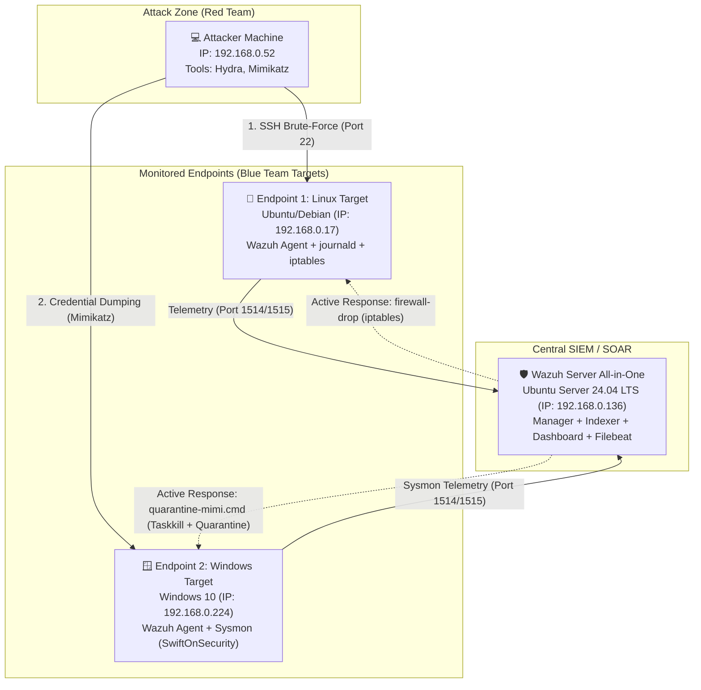

# 🛡️ Wazuh SIEM & EDR Deployment: Detection Engineering & SOAR Home Lab

> 🌐 **Language:** [English](README_EN.md) | [Polski](README.md)

## 📋 Executive Summary

This project demonstrates the end-to-end design, deployment, and maintenance of a centralized **SIEM/EDR** security monitoring environment built in an *On-Premise* architecture. The primary objective of this home lab is to showcase practical, hands-on skills in:

* **Detection Engineering:** Crafting custom correlation rules based on Linux system logs (`journald`) and advanced Windows endpoint telemetry (`Sysmon`), fully mapped to the **MITRE ATT&CK** framework (`T1110`, `T1003`).
* **Security Orchestration, Automation, and Response (SOAR / Active Response):** Configuring automated defense mechanisms that mitigate threats in real time without analyst intervention—automatically dropping attacker traffic via `iptables` on Linux and autonomously terminating malicious processes and purging payloads (`Mimikatz`) on Windows endpoints.
* **SIEM Infrastructure Administration & Troubleshooting:** Resolving real-world production challenges, including Logical Volume Management (LVM) storage expansion, service authentication (Filebeat Keystore, OpenSearch Security, RBAC API), `systemd` service diagnostics, and adapting Active Response execution scripts to match agent telemetry schemas.

---

## 🏗️ Lab Topology & Architecture

The environment is built using virtualization in a **Bridged Network** configuration, simulating realistic network traffic across a local LAN segment (`192.168.0.0/24`).



### Component Specification:

| Architectural Role | Operating System | IP Address | Key Modules & Configuration |
| :--- | :--- | :--- | :--- |
| **Wazuh Server (SIEM)** | Ubuntu Server 24.04 LTS | `192.168.0.136` | Wazuh Manager, Wazuh Indexer, Wazuh Dashboard, Filebeat (`v4.14.9`) |
| **Endpoint 1 (Linux Target)** | Ubuntu / Debian | `192.168.0.17` | Wazuh Agent, log collection via `systemd-journald`, `iptables` host firewall |
| **Endpoint 2 (Windows Target)** | Windows 10 Pro | `192.168.0.224` | Wazuh Agent, **Sysmon** (*SwiftOnSecurity* config), `Operational` event channel |
| **Attacker Host (Red Team)** | Linux Host | `192.168.0.52` | THC-Hydra (SSH Brute-Force), network diagnostic utilities (`ICMP/ping`) |

---

## 📁 Repository Structure (Configuration Artifacts)

This repository contains the core configuration files and custom scripts developed during the deployment:

```text
├── README.md                                  # Technical documentation and deployment report (PL)
├── README_EN.md                               # Technical documentation and deployment report (EN)
├── local_rules.xml                            # Custom detection rules (ID 100002, ID 100005)
├── manager-active-response.conf               # Manager <command> and <active-response> definitions
├── windows_agent_sysmon.conf                  # Windows agent Sysmon Operational channel integration
├── quarantine-mimi.py                         # Mimikatz artifact quarantine script
└── quarantine-mimi.cmd                        # Windows Active Response launcher
```

---

## 🚀 Phase 1: Deployment & Log Ingestion

### 1. Central Wazuh Server (`192.168.0.136`)
An *All-in-One* architecture was deployed comprising the analytical engine (Wazuh Manager), OpenSearch-based database (Wazuh Indexer), and web interface (Wazuh Dashboard). Role-Based Access Control (RBAC), internal certificates, and credential keystores were hardened and synchronized (see the *Troubleshooting Log* section for details).


### 2. Linux Agent Configuration (`192.168.0.17`)
* Installed and registered the Wazuh Agent (`v4.14.9`) forcing package retrieval over IPv4.
* Configured authentication event collection directly from `systemd-journald` by granting the `wazuh` service account membership in the `systemd-journal` system group.

### 3. Windows Agent Configuration & Sysmon Integration (`192.168.0.224`)
Default Windows Security Event Logs often lack granular visibility into process creation arguments or file system modifications. To elevate detection capabilities to an **EDR** standard:
* Deployed **Sysmon (System Monitor)** using the industry-standard *SwiftOnSecurity* baseline configuration.
* Configured `ossec.conf` on the Windows endpoint to ingest events directly from the dedicated `Microsoft-Windows-Sysmon/Operational` event channel:

```xml
<localfile>
  <location>Microsoft-Windows-Sysmon/Operational</location>
  <log_format>eventchannel</log_format>
</localfile>
```
This allows the SIEM to parse high-value telemetry in real time, including **Event ID 1** (Process Creation), **Event ID 3** (Network Connection), and **Event ID 11** (FileCreate).

---

## ⚔️ Scenario 1: SSH Brute-Force Attack & Automated Blocking (Linux SOAR)

### 1. Attack Simulation (Red Teaming — MITRE ATT&CK: `T1110`)
From the attacker machine (`192.168.0.52`), a dictionary-based *Brute-Force* attack was launched against the SSH service on the Linux target (`192.168.0.17`) using **THC-Hydra**:
* **Target Service:** `ssh://192.168.0.17:22`
* **Targeted Account:** `polafasola2`
* **Log Artifacts:** High-frequency authentication failure events recorded by `journald` for the `sshd` daemon.

### 2. Detection Engineering (Custom Rule `100002`)
In `/var/ossec/etc/rules/local_rules.xml` on the Wazuh Manager, a custom correlation rule was engineered to aggregate individual SSH authentication failures (built-in rule `5760` — *sshd: authentication failed*).


```xml
<group name="local,syslog,sshd,">
  <rule id="100002" level="10" frequency="5" timeframe="60">
    <if_matched_sid>5760</if_matched_sid>
    <same_source_ip />
    <description>SSH Brute Force detected: 5 failed logins within 60 seconds from IP $(srcip)</description>
    <mitre>
      <id>T1110</id>
    </mitre>
  </rule>
</group>
```
* **Detection Logic:** If 5 events matching rule ID `5760` originate from the same source IP address (`<same_source_ip />`) within a 60-second window, the SIEM escalates the alert severity from level `5` to level `10` (triggering rule `100002`) and maps the activity to **MITRE T1110 (Brute Force)**.

### 3. Active Response Configuration (SOAR)
To automatically mitigate the attack, rule `100002` was bound to the `firewall-drop` execution script inside the Manager's primary configuration file (`/var/ossec/etc/ossec.conf`):

```xml
<active-response>
  <disabled>no</disabled>
  <command>firewall-drop</command>
  <location>local</location>
  <rules_id>100002</rules_id>
  <timeout>600</timeout>
</active-response>
```
When rule `100002` is triggered, the Wazuh Manager dispatches an immediate command to the affected agent (`<location>local</location>`), inserting the attacker's IP address into the local firewall drop chain for 600 seconds.

### 4. Verification & Proof of Concept (PoC)

**Step A: Attack Detection and Event Correlation in Wazuh Dashboard**  
The SIEM accurately logged individual failed login attempts (rule `5760`, level 5) and generated the correlated high-severity alert (rule `100002`, level 10, overriding the default rule `5763`) indicating an active Brute-Force attack against user `polafasola2`.


**Step B: Automated Firewall Table Modification (`iptables`) on the Victim Host**  
Inspecting the firewall rules on `192.168.0.17` confirmed the automatic insertion of a `DROP` rule for the attacker's IP address (`192.168.0.52`) across both the `INPUT` and `FORWARD` chains.


**Step C: Confirming Attacker Isolation (Connectivity Test)**  
From the attacker's perspective (`192.168.0.52`), ICMP tests showed **100% packet loss** when attempting to reach the target, while the protected Linux endpoint (`192.168.0.17`) maintained uninterrupted communication with the Wazuh Manager (`192.168.0.136`).


---

## 🪟 Scenario 2: Mimikatz Detection & Neutralization on Windows Endpoint (EDR & Sysmon)

### 1. Attack Simulation (MITRE ATT&CK: `T1003` — OS Credential Dumping)
On the Windows 10 workstation (`192.168.0.224`), after intentionally disabling Windows Defender real-time protection (simulating a breach of the primary antivirus layer / *Defense Evasion*), an attempt was made to stage and execute **Mimikatz** to extract credentials from the LSASS process memory.

### 2. Telemetry Capture via Sysmon
Thanks to the `Microsoft-Windows-Sysmon/Operational` channel integration, the malicious activity was immediately intercepted during the payload staging phase (*Delivery* — **Sysmon Event ID 11: FileCreate**) and process initialization (**Sysmon Event ID 1: Process Creation**), before the attacker could perform a full memory dump.


### 3. Detection Engineering (Custom Rule `100005`)
To isolate credential dumping attempts from general Sysmon telemetry, a custom high-severity detection rule (**ID 100005**, severity level `12` — *High/Critical*) was created to match `mimikatz` indicators across the `sysmon` rule group:

```xml
<group name="windows,sysmon,mimikatz_detection,">
  <rule id="100005" level="12">
    <if_group>sysmon</if_group>
    <match type="pcre2">(?i)mimikatz</match>
    <description>CRITICAL EDR ALERT: Mimikatz activity detected on Windows endpoint (Host: $(win.system.computer))</description>
    <mitre>
      <id>T1003</id>
    </mitre>
  </rule>
</group>
```

### 4. Automated Endpoint Remediation (Windows Active Response)
Because Sysmon events (Event ID 1 / Event ID 11) represent local host operations and do not populate a `srcip` field in their JSON alert structure, default network-based Active Response scripts (such as `netsh` IP blocking) cannot be used (see *Troubleshooting Log – Issue 5*).

Instead of network isolation, a host-based EDR remediation workflow was designed to directly neutralize the process and preserve the binary for forensic analysis:

**A. Custom Execution Script on the Windows Endpoint (`C:\Program Files (x86)\ossec-agent\active-response\bin\quarantine-mimi.py`):**
The script reads the Active Response alert from standard input, forcefully terminates the Mimikatz process using `taskkill`, moves the indicated file to `C:\Quarantine` instead of deleting it, adds the `.locked` extension, calculates its SHA-256 hash, and writes an audit entry to `active-responses.log`. The `quarantine-mimi.cmd` launcher starts the Python script because the Windows agent executes Active Response scripts through executables or batch launchers:

```cmd
@echo off
setlocal
set "SCRIPT_DIR=%~dp0"
if defined WAZUH_PYTHON set "PYTHON=%WAZUH_PYTHON%"
if not defined PYTHON set "PYTHON=py.exe"
"%PYTHON%" "%SCRIPT_DIR%quarantine-mimi.py"
exit /b %ERRORLEVEL%
```

**B. Trigger Configuration on the Wazuh Manager (`/var/ossec/etc/ossec.conf`):**

```xml
<command>
  <name>quarantine_mimi</name>
  <executable>quarantine-mimi.cmd</executable>
  <timeout_allowed>no</timeout_allowed>
</command>

<active-response>
  <disabled>no</disabled>
  <command>quarantine_mimi</command>
  <location>local</location>
  <rules_id>100005</rules_id>
</active-response>
```
Whenever rule `100005` is triggered, the Wazuh Manager instructs the Windows agent (`<location>local</location>`) to execute `quarantine_mimi`, terminating the process and preserving the payload in quarantine for forensic analysis.

---

## 🔧 Engineering Challenges & Troubleshooting Log

Building the infrastructure from scratch involved diagnosing and resolving several system administration and architectural issues typical of production SIEM/EDR deployments:

### 1. LVM Disk Space Exhaustion During Dashboard Installation (`disk full error`)
* **Diagnosis:** Installing the `wazuh-dashboard` package (over 1 GB unpacked due to Node.js dependencies) failed with a `dpkg-deb` broken pipe error. Inspecting `/var/log/wazuh-install.log` revealed a `disk full error` on the root `/` partition. By default, the Ubuntu Server 24.04 installer allocated only 50% of the virtual disk (24 GB out of 50 GB) to the `ubuntu-lv` logical volume.
* **Resolution:** Expanded the LVM logical volume online (without data loss or rebooting) to utilize 100% of the free space in the volume group:
  ```bash
  sudo lvextend -l +100%FREE /dev/ubuntu-vg/ubuntu-lv
  sudo resize2fs /dev/ubuntu-vg/ubuntu-lv
  ```

### 2. Wazuh API `Error 900` and Dashboard Connectivity Loss (`BrokenProcessPool`)
* **Diagnosis:** The Wazuh Dashboard reported that API connections on port `55000` were down, while direct `curl` requests returned `Unauthorized` or `Error 900 (One of the API child processes terminated abruptly)`. Reviewing `/var/ossec/logs/api.log` revealed a `BrokenProcessPool` exception caused by orphaned daemon processes (`wazuh_apid.py`, `wazuh-db`) and RBAC database desynchronization following memory pressure events.
* **Resolution:** Forcefully terminated orphaned Wazuh processes (`pkill -9`), reset the Role-Based Access Control database (`rbac.db`), authenticated via JWT tokens to issue `PUT /security/users/{id}` requests setting new credentials for `wazuh` and `wazuh-wui`, and synchronized the updated password in `/usr/share/wazuh-dashboard/data/wazuh/config/wazuh.yml`.

### 3. Missing Alerts in Wazuh Dashboard (`Filebeat Error 401 Unauthorized`)
* **Diagnosis:** Although the Wazuh Manager accurately logged SSH attacks in `/var/ossec/logs/alerts/alerts.log`, no new events appeared in the web UI. Inspecting the `filebeat` service logs revealed `401 Unauthorized` errors when attempting to push indices to Wazuh Indexer after a manual `admin` password reset in OpenSearch Security.
* **Resolution:** Updated the encrypted Filebeat Keystore with the new Indexer `admin` password and restarted the forwarder service:
  ```bash
  sudo filebeat keystore add password
  sudo systemctl restart filebeat
  ```

### 4. Wazuh Indexer Startup Failure (`java.nio.file.AccessDeniedException`) & `journald` Permissions
* **Diagnosis:** Following security re-initialization, the Wazuh Indexer cluster failed to start (`status=1/FAILURE`), throwing Java `AccessDeniedException` errors on configuration and backup directories. Concurrently, on the Linux endpoint, the `wazuh` agent user lacked permissions to read the system journal.
* **Resolution:**
  * On the SIEM server, recursively restored ownership (`chown -R wazuh-indexer:wazuh-indexer`) and `750` permissions across `/etc/wazuh-indexer`, `/var/lib/wazuh-indexer`, and `/var/log/wazuh-indexer`, then re-initialized cluster security via `indexer-security-init.sh`.
  * On the Linux agent, added the service account to the journal group (`usermod -aG systemd-journal wazuh`), restoring full visibility into SSH logs.

### 5. Default Network Active Response Scripts Failing on Windows (`Cannot read 'srcip' from data`)
* **Diagnosis:** The initial Active Response design for Windows attempted to use the built-in `netsh.exe` script to block network traffic upon detecting Mimikatz. Reviewing `C:\Program Files (x86)\ossec-agent\active-response\active-responses.log` revealed the error: `Cannot read 'srcip' from data`.
* **Root Cause:** Sysmon alerts (Event ID 1 / Event ID 11) represent local process and file operations; consequently, their JSON alert payload does not contain a `data.srcip` field, which built-in firewall scripts require.
* **Resolution:** Pivoted the mitigation strategy from network-based blocking to host-based EDR process/file remediation. Engineered `quarantine-mimi.py`, which does not depend on `srcip`, uses `taskkill` to terminate the process, and moves the malicious file to quarantine instead of deleting forensic evidence.

### 6. Manager Configuration Validation Failure (`wazuh-manager.service` Crash)
* **Diagnosis:** After adding the Windows Active Response configuration, restarting the Wazuh Manager failed with `Job for wazuh-manager.service failed because the control process exited with error code`.
* **Root Cause:** Inspecting `sudo journalctl -xeu wazuh-manager.service` uncovered two XML configuration issues in `/var/ossec/etc/ossec.conf`: setting `<location>defined-agent</location>` without specifying a corresponding `<agent_id>`, and leaving a duplicate `<active-response>` block referencing `netsh` for rule `100005`.
* **Resolution:** Removed the duplicate XML block, unified the command reference to `quarantine_mimi`, and set `<location>local</location>` (instructing the SIEM to execute the remediation script directly on whichever agent generated the alert).
